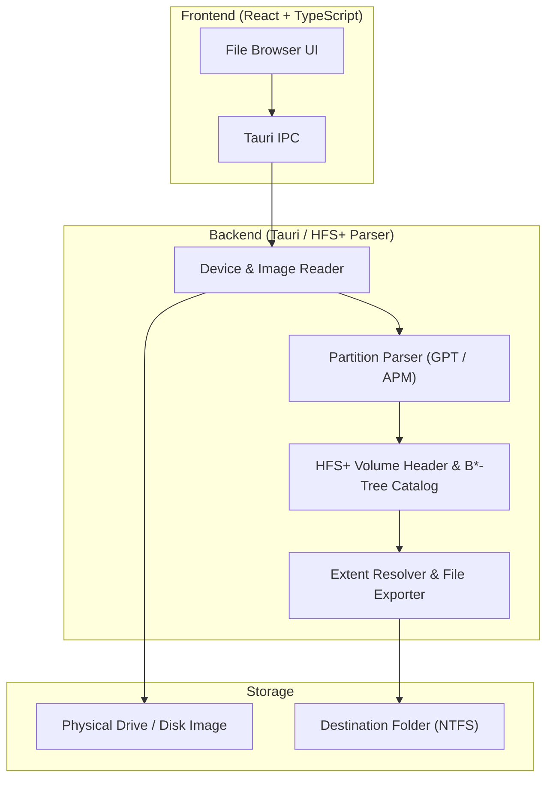

# hfs-explorer

Windows desktop application for browsing and extracting files from Apple HFS+ (Mac OS Extended) formatted drives and disk images (`.dmg`, `.img`, `.raw`, `.iso`). Built with Tauri v2, React, TypeScript, and a read-only HFS+ parser.

---

## Overview

Windows does not natively read Apple's HFS+ filesystem. When a Mac-formatted drive or USB stick is connected, Windows prompts to reformat it.

`hfs-explorer` reads HFS+ volumes in user space without installing kernel drivers:

- **Physical Drives & Disk Images:** Reads raw sectors (`\\.\PhysicalDriveN`, `\\.\X:`) via the Windows API, as well as `.dmg`, `.img`, `.raw`, `.iso`, and `.bin` image files.
- **Read-Only Access:** Opens devices and images strictly in read-only mode.
- **Directory Browser & Extractor:** Browse directory trees, inspect volume metadata (block size, capacity, allocation), filter files, and copy files or folders to NTFS.
- **Sample Image Generator:** Includes a built-in generator that creates a 16 MB HFS+ test image (`test-volume.img`) for local testing without a physical Mac drive.

---

## Architecture



### HFS+ Details Implemented

- **Volume Header:** Reads sector 2 (byte offset 1024), verifying `0x482B` (`H+`) and `0x4858` (`HFSX`) signatures.
- **B*-Tree Catalog:** Traverses header, index, and doubly-linked leaf nodes (`fLink` / `bLink`).
- **Timestamps & Strings:** Converts HFS+ 32-bit timestamps (seconds since Jan 1, 1904) to UTC and decodes UTF-16BE decomposed filenames.
- **Partition Tables:** Detects GUID Partition Table (GPT, `48465300-0000-11AA-AA11-00306543ECAC`) and Apple Partition Map (APM).

---

## Development & Build

### Prerequisites (Windows)

- Node.js (LTS)
- Rust toolchain (`rustup`)
- Microsoft Visual Studio C++ Build Tools

### Run Locally

```powershell
git clone https://github.com/whysari/hfs-explorer.git
cd hfs-explorer
npm install
npm run tauri dev
```

### Build Installer

```powershell
npm run tauri build
```

Installers (`.msi` and `.exe`) are output to `src-tauri/target/release/bundle/`.

---

## License

MIT — see [LICENSE](LICENSE).
