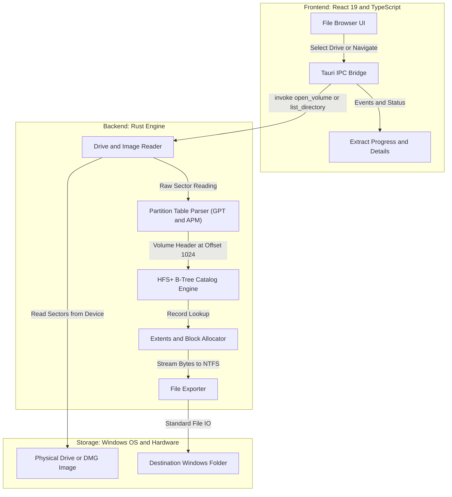

# hfs-explorer 🍏 🔍

> A blazing-fast, open-source desktop application to read, browse, and extract Apple HFS+ (Mac OS Extended) formatted drives and disk images directly on Windows. Built with **Rust**, **Tauri v2**, **React 19**, and **Tailwind CSS**.

[](https://www.rust-lang.org/)
[](https://tauri.app/)
[](https://react.dev/)
[](LICENSE)
[](https://microsoft.com)

---

## 📖 Overview

Windows does not natively support Apple's **HFS+ (Hierarchical File System Plus / Mac OS Extended)** filesystem. When you connect an external hard drive or USB formatted on a Mac, Windows flags it as unreadable or prompts you to format it (which erases your data!).

**`hfs-explorer`** solves this by providing direct low-level block I/O in Rust:
- **Zero Drivers Needed:** Does not require unstable third-party kernel drivers or MacDrive.
- **Physical Drive & USB Support:** Directly reads raw sectors (`\\.\PhysicalDriveN` and `\\.\X:`) via the Windows API.
- **Disk Image Support:** Opens `.dmg`, `.img`, `.raw`, `.iso`, and `.bin` disk images directly.
- **Safe Read-Only:** All operations are strictly read-only, guaranteeing zero risk of data corruption on your Apple volumes.
- **Native Performance:** Powered by a pure Rust HFS+ engine that parses B*-Tree catalog records in microseconds.
- **Lightweight:** Tauri v2 leverages the Windows WebView2 runtime, consuming only ~40 MB of RAM (compared to 300+ MB in Electron apps).

---

## ✨ Features

- 🗂️ **Hierarchical Directory Browser:** macOS Finder-inspired dual-pane view with breadcrumb navigation and deep folder traversal.
- 💾 **Drive Detection:** Automatically enumerates connected external USB drives and physical disk units.
- 📥 **Streaming File Extractor:** Extract files of any size directly to Windows NTFS without memory bloat.
- 🧪 **Built-in Test Image Generator:** Create a self-contained 16 MB Apple HFS+ disk image (`.img`) with one click to test the parser instantly.
- 🔍 **Instant Search:** Real-time filtering across files and folders.
- 📊 **Volume Inspector:** View block sizes, allocation metrics, total capacity, free space, and timestamps.

---

## 🏗️ Architecture



### HFS+ Specifications Implemented:
- **Volume Header:** Sector 2 (byte offset 1024), signature `0x482B` (`H+`) and `0x4858` (`HFSX`).
- **Mac Epoch Conversion:** Converts Mac 32-bit timestamps (seconds since January 1, 1904) to standard ISO-8601 UTC.
- **B*-Tree Catalog Parsing:** Traverses Header nodes, Index nodes, and doubly-linked Leaf nodes (`fLink` / `bLink`).
- **Unicode Filenames:** Decodes UTF-16 Big-Endian decomposed filenames.
- **Partition Maps:** Autodetects both GUID Partition Table (GPT, GUID `48465300-0000-11AA-AA11-00306543ECAC`) and Apple Partition Map (APM).

---

## 🚀 Getting Started

### Prerequisites

Ensure you have the following installed on Windows:
1. **Git:** `winget install --id Git.Git -e`
2. **Node.js (LTS):** `winget install --id CoreyButler.NVMforWindows -e` followed by `nvm install lts`
3. **Rust:** `winget install --id Rustlang.Rustup -e` followed by `rustup default stable`
4. **C++ Build Tools (MSVC):**
   ```powershell
   winget install --id Microsoft.VisualStudio.2022.BuildTools -e --override "--passive --wait --add Microsoft.VisualStudio.Workload.VCTools --includeRecommended"
   ```

### Installation & Development

```powershell
# Clone the repository
git clone https://github.com/<your-username>/hfs-explorer.git
cd hfs-explorer

# Install frontend dependencies
npm install

# Run in development mode (launches Vite + Tauri dev window)
npm run tauri dev
```

### Production Build

To compile a standalone Windows installer (`.msi` and `.exe`):

```powershell
npm run tauri build
```

The resulting binaries will be located in `src-tauri/target/release/bundle/`.

---

## 🧪 Testing with a Sample Image

You don't need a physical Mac drive to test:
1. Launch `hfs-explorer`.
2. Click **"Create Test HFS+ Image"** in the sidebar.
3. Save `test-volume.img` to any location.
4. The app will immediately load the newly generated Apple HFS+ volume, allowing you to browse folders (`Documents/`, `Pictures/`) and extract sample files (`hello_apple.txt`, `notes.txt`, `apple_logo.png`).

---

## 🤝 Contributing

Contributions are very welcome! Please see [CONTRIBUTING.md](CONTRIBUTING.md) for details on code style, testing, and pull request guidelines.

---

## 📄 License

This project is open-source under the [MIT License](LICENSE).
